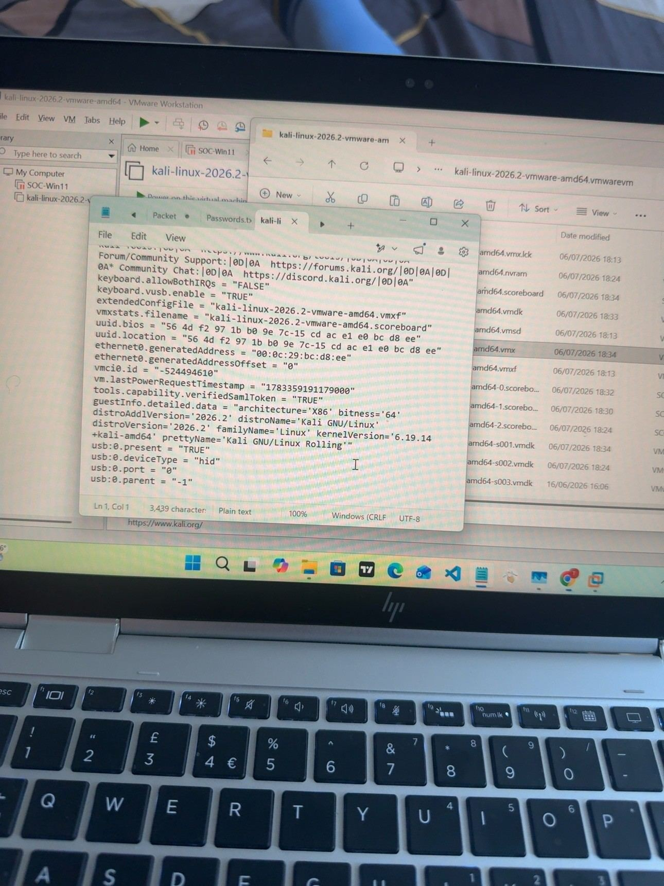

# 01 - Virtualisation and Lab Environment

## Overview

This section documents the virtualisation environment used to build my SOC home lab.

The lab was deployed using VMware Workstation Pro on a Windows 11 host, providing isolated virtual machines for endpoint monitoring, security testing and investigation.

## Lab Components

| Component | Purpose |
|---|---|
| VMware Workstation Pro | Virtualisation platform |
| Windows 11 VM | Security monitoring and endpoint investigation |
| Kali Linux VM | Network reconnaissance and testing |
| VMware Tools | Virtual machine integration |

## Activities Completed

- Installed and configured VMware Workstation Pro.
- Deployed a Windows 11 virtual machine.
- Deployed a Kali Linux virtual machine.
- Configured virtual machine resources and networking.
- Installed VMware Tools.
- Created recovery snapshots.
- Prepared the environment for endpoint monitoring and security investigations.

## Security Objectives

The virtual environment provides a controlled lab for:

- Windows endpoint monitoring.
- Network reconnaissance.
- Sysmon event collection and analysis.
- Security event investigation.
- SIEM and cloud security exercises.

## Evidence

### Kali Linux Virtual Machine Configuration

The screenshot below demonstrates the Kali Linux virtual machine configuration used within the SOC home lab.

---

**Project:** Enterprise SOC Home Lab  
**Platform:** VMware Workstation Pro
