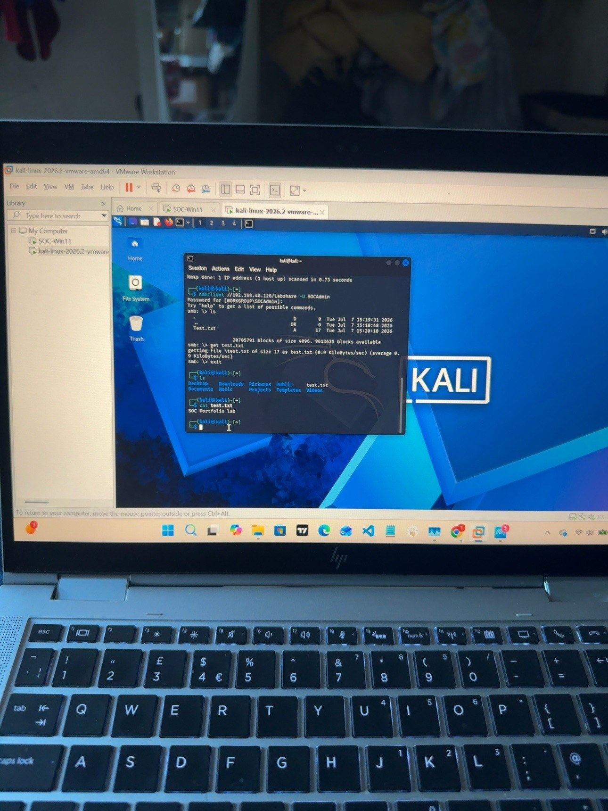
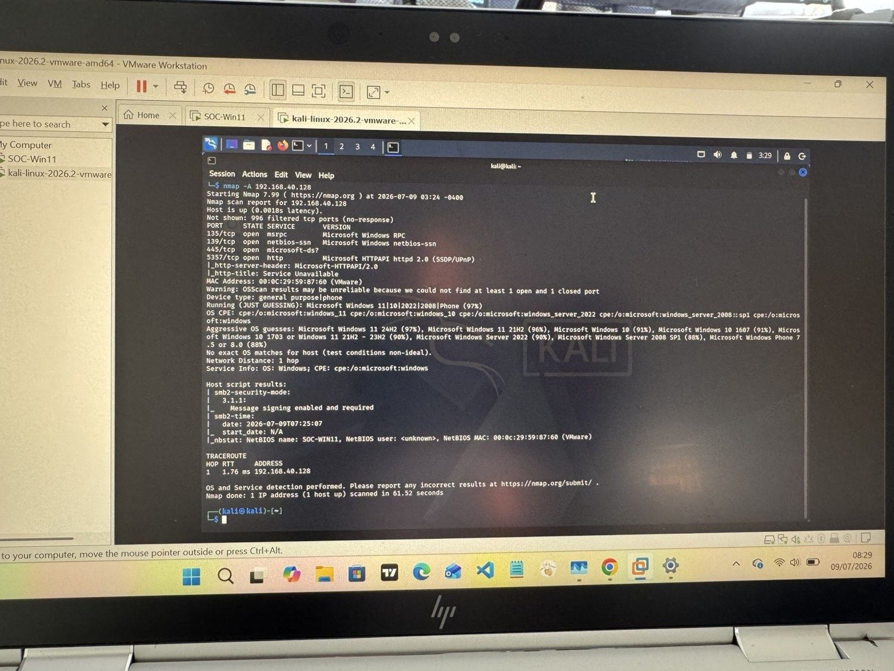
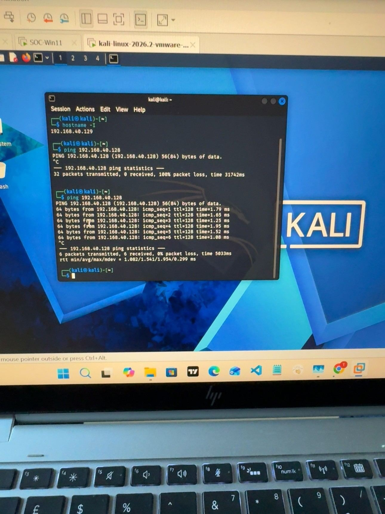

# 02 - Network Reconnaissance and SMB Investigation

## 1. Overview

This project documents network connectivity testing, service discovery and Server Message Block (SMB) file-sharing investigation conducted within my SOC home lab.

The investigation used Kali Linux as the testing machine and Windows 11 as the target endpoint. Both virtual machines communicated through NAT networking in a controlled environment.

## 2. Lab Environment

| Component | Configuration |
|---|---|
| Testing machine | Kali Linux |
| Target machine | Windows 11 |
| Network mode | NAT |
| Windows IP | 192.168.40.128 |
| Kali Linux IP | 192.168.40.129 |
| SMB service | TCP 445 |
| Virtualisation | VMware Workstation Pro |

## 3. Activities Performed

### 3.1 Network Connectivity Testing

- Identified the IP address of the Kali Linux virtual machine.
- Tested connectivity to the Windows 11 endpoint.
- Observed an initial failed ping followed by successful replies.
- Verified network communication between both virtual machines.

**Result:** Network connectivity between Kali Linux and Windows 11 was successfully established.

### 3.2 Nmap Network Reconnaissance

Performed Nmap reconnaissance against the Windows endpoint at `192.168.40.128`.

The scan identified the target as active and revealed the following open TCP ports:

| Port | Service | Purpose |
|---|---|---|
| 135 | MSRPC | Microsoft RPC |
| 139 | NetBIOS-SSN | NetBIOS session service |
| 445 | Microsoft-DS | SMB file sharing |
| 5357 | HTTP | Microsoft HTTPAPI |

The scan also identified 996 filtered TCP ports.

**Additional observation:**
- SMB message signing was reported as enabled and required.
- Service and operating system detection information was returned by Nmap.

**Result:** Successfully identified exposed network services and gathered information about the Windows endpoint.

### 3.3 SMB Share Investigation

Investigated SMB file sharing between Kali Linux and the Windows 11 endpoint.

Activities included:

- Accessed the Windows SMB share from Kali Linux.
- Authenticated to the shared resource.
- Listed available files within the share.
- Identified `test.txt`.
- Retrieved the file using SMB client functionality.
- Verified the downloaded file in the Kali Linux environment.

**Result:** Successfully accessed the SMB share and transferred a test file between the Windows and Kali Linux environments.

## 4. Security Observations

The investigation demonstrated several important security monitoring considerations:

1. Open ports 135, 139 and 445 expose Windows networking and file-sharing services.
2. SMB provides an important area for investigating authentication and file-access activity.
3. Network reconnaissance helps identify active hosts and exposed services.
4. SMB message signing was enabled and required on the observed endpoint.
5. Connectivity testing helps establish whether endpoints can communicate before further investigation.

## 5. Evidence

Screenshots extracted from the SOC Analyst Portfolio Master Journal.

### Network Connectivity and SMB Validation

### Nmap Service and Version Reconnaissance

### Kali-to-Windows Connectivity

## 6. Skills Demonstrated

- Network reconnaissance
- Nmap service discovery
- Network connectivity troubleshooting
- TCP port identification
- SMB enumeration
- SMB client authentication
- File-share investigation
- Linux command-line operations
- Windows network service analysis
- Technical documentation and evidence management

## 7. Project Outcome

Successfully established communication between Kali Linux and Windows 11, identified exposed Windows services through Nmap reconnaissance, and investigated SMB file sharing through authentication and file transfer.

This exercise forms part of my practical development towards Security Operations Centre (SOC) analysis, network investigation and security monitoring.

---

**Project:** Enterprise SOC Home Lab  
**Platform:** VMware Workstation Pro  
**Testing Environment:** Kali Linux  
**Target Environment:** Windows 11
